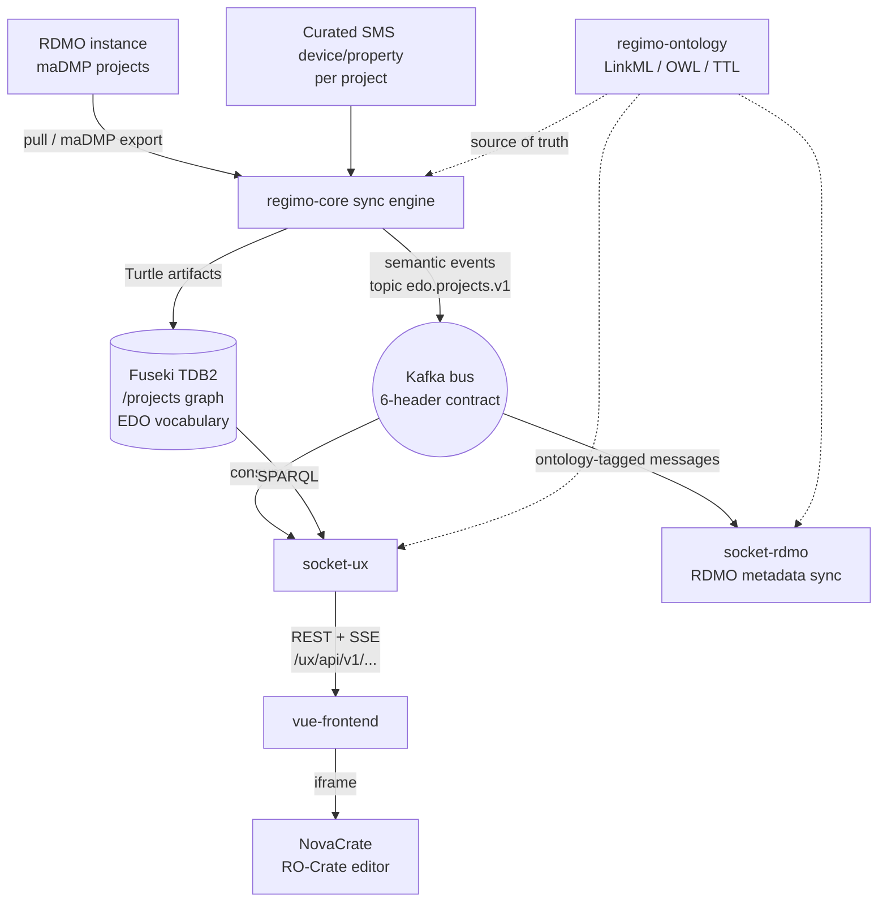

# edo — Energy Data Orchestrator (Regimo ecosystem)

**edo** is an *ontology-aware Energy Data Orchestrator*: a microservice-based framework for intelligent
energy-system integration over a **Kafka** event bus, developed at the **Karlsruhe Institute of Technology (KIT)**
(KITopen-ID: 1000168804). The semantic models in [`regimo-ontology`](https://github.com/EnergyDataOrchestrator/regimo-ontology)
are the **single source of truth**; all functional microservices ("sockets") are ontology-aware and exchange
data through a standardised Kafka contract.

`edo` itself is the **umbrella repository**: it contains little component code, but pins every component
repository as a **Git submodule** at a specific commit — see [`edo/README.md`](https://github.com/EnergyDataOrchestrator/edo/blob/main/README.md)
for the full submodule workflow, pitfalls and command reference.

## Repositories

| Repository | Role in edo | Purpose |
| :--- | :--- | :--- |
| [`edo`](https://github.com/EnergyDataOrchestrator/edo) | Umbrella | Pins all components as submodules; owns compose files, `pyproject.toml`/`uv.lock`, the Qt desktop client, helper scripts and the research documentation (`projecting_spaces/`). |
| [`regimo-ontology`](https://github.com/EnergyDataOrchestrator/regimo-ontology) | `schema/ontology/` | **Semantic backbone** (single source of truth): OWL/TTL models, LinkML schemas, generated bindings (Pydantic, Java POJOs, JSON/Avro schemas) and translation bindings. |
| [`regimo-core`](https://github.com/EnergyDataOrchestrator/regimo-core) | `core/` | **Engine library**: Kafka producer/consumer patterns, the 6-header message contract, socket base classes, and the RDMO→Fuseki sync engine (`regimo-core sync`). |
| [`regimo-infrastructure`](https://github.com/EnergyDataOrchestrator/regimo-infrastructure) | `infrastructure/` | **Ops**: deployment and configuration-as-code for the Kafka bus (topics, retention, security), Docker/Kubernetes, monitoring (Prometheus/Grafana). |
| [`socket-rdmo`](https://github.com/EnergyDataOrchestrator/socket-rdmo) | `components/socket-rdmo/` | Bridge socket between the energy bus and **RDMO** (Research Data Management Organiser): maDMP export plugin, semantic mapping of energy data to RDM metadata. |
| [`vue-frontend`](https://github.com/EnergyDataOrchestrator/vue-frontend) | `frontend/vue-frontend/` | Web frontend (project drawer, NovaCrate RO-Crate editor integration). |
| *(in `edo`)* `frontend/qt-frontend/EdoClient/` | — | PyQt6/QML desktop client with role-based access control (guest/fellow/steward/admin) and Qt Design Studio support. |
| *(in `edo`)* `components/socket-ux/` | — | Ontology-aware API socket for the vue-frontend (projects/values from the internal graph DB, SSE live events, on-demand RO-Crate). |
| *(in `edo`)* `components/utils/` | — | Helper scripts, e.g. the canonical maDMP bus round-trip (`kafka/roundtrip_madmp.py`). |

Related repositories in the same workspace (not submodules of `edo`):

- **`regimo`** — the publishing tool: tracks new files of an EDR recording campaign, uploads them to the cloud and publishes them to the databus (use cases UC1/UC2, metadata-source configuration).
- **`edokit`** — compose file bundling RDMO-App, RDMO-DB, MetaStore, Regimo and Dagster for local development.
- **`StageHMC`** — submodule registered in `edo/.gitmodules` (visualization/staging work).

## Architecture



Key architectural facts:

- **Kafka bus with an ontology-aware header contract.** Every message carries six headers —
  `socket_id`, `ontology_uri`, `project_id`, `schema_id`, `timestamp`, `lineage` — defined once in
  `regimo_core.interfaces.message` (`ORDERED_HEADER_KEYS`). Never add a header without updating the
  contract, the serialiser and the tests together.
- **Internal format as pivot.** RDMO maDMP exports and SMS device/property records are transformed into an
  **internal format** (linked DMP+SMS pivot graph, LinkML schema `05_P05_S05_internal-format-schema.yaml`,
  EDO vocabulary `https://w3id.org/edo/terms/` mixed with Dublin Core, DCAT, FOAF, PROV, SOSA and SMS CVs).
  The internal format *is* the ontology-aware representation — no separate translation step at read time.
- **Storage.** The internal-format project graphs live in an Apache Jena **Fuseki** TDB2 dataset `/projects`
  (fuseki-proto prototype, host port **3031**; SHACL shapes under `shapes/project-claim-shapes.ttl`).
- **Sync engine (regimo-core).** A pull-based sync: list RDMO projects → pull each maDMP → digest (SHA-256)
  → transform via the canonical LinkML-Map rules → write one Turtle artifact per project → replace the
  Fuseki default graph → publish one semantic event per change (`project.created/updated/removed`) on
  `edo.projects.v1`. Unchanged projects are skipped via a persisted digest; SMS devices/properties are
  curated per project under `data/regimo-core/sms/<project_id>/`.
- **Sockets.** Each microservice lives in its own `socket-<unit>` repository for independent scaling and
  deployment; `regimo-core` provides the socket base classes and bus logic, a `socket-template` is planned
  as boilerplate for new components.
- **Frontends.** The vue-frontend talks to `socket-ux` (`GET /api/v1/projects`, `/{pid}/values`,
  `/{pid}/crate`, `GET /api/v1/events` SSE) and embeds a self-hosted **NovaCrate** RO-Crate editor via
  iframe. Kafka is invisible to the end user: without a broker, socket-ux keeps working.

## Transformation & provenance pipeline (`projecting_spaces`)

`projecting_spaces/EDO/` holds the research documentation using the "Projecting" methodology
(content-first cards `CF1`–`CF4`, fragments, artefacts). The Artefacts contain the reproducible pipeline:

1. **Internal-format schema** — LinkML schema (`07_Fragments/scripts/linkml/05_P05_S05_internal-format-schema.yaml`); a generated JSON Schema with a **provenance RO-Crate** documenting exactly how that version was produced (`05_P05_S05_internal-format-json-schema-crate/`, incl. `reproduce.sh`).
2. **Transformation catalogue & maps** — `07_Fragments/scripts/trafos/`: every DMP→internal rule (`P1–P42`) and SMS→internal rule (`S1–S16`) in `patterns.md`, realised **two ways**: hand-coded Python (`fuseki-proto trip`, CF2-003) and map-driven via **LinkML Map** files (`fuseki-proto agnostic-trip`, CF2-004). Both variants round-trip with 41/41 field-level checks and isomorphic graphs.
3. **Fuseki prototype** — `07_Fragments/scripts/fuseki-proto/`: local Fuseki Full from source (TDB2 `/projects`, SHACL shapes `/shapes`), with a maintenance CLI (`fuseki-proto start/stop/backup/restore/load/wipe/trip/agnostic-trip/crate`).
4. **RO-Crate generation** — `fuseki-proto crate generate` (CF2-006) builds a self-contained **RO-Crate 1.1** package from the linked internal-format instance using `ro-crate-py`, then zips it; validate the whole directory with [nova-crate](https://novacrate.datamanager.kit.edu/editor). A committed example crate (`cf2-006-weatherstation.crate/`) covers the linked weatherstation instance.
5. **CF1 sync** — the RDMO→Fuseki→Kafka sync engine described above lives in `regimo-core` (`sync/`).

## Getting started

```bash
# Clone edo together with all submodules
git clone --recurse-submodules git@github.com:koubaa-hmc/edo.git
cd edo
# (or populate later: git submodule update --init --recursive)

# Python tooling (>=3.12, uv; creates .venv from pyproject.toml / uv.lock)
uv sync

# Start Kafka (optionally with schema registry + sockets)
docker compose up -d                              # Kafka + Zookeeper
docker compose -f docker-compose_w_semantic_layer.yml up -d   # + Schema Registry, sockets, NovaCrate
```

After cloning, each submodule is in **detached HEAD** at the commit pinned by `edo` — switch to a branch
before changing anything. Changing a component always needs **two commits in two repositories**: first in
the component repo, then the submodule-pointer bump in `edo` (push the component **before** pushing `edo`).
The full step-by-step, pull/bump recipes, pitfalls table and command reference are in
[`edo/README.md`](https://github.com/EnergyDataOrchestrator/edo/blob/main/README.md).

Quick runs per component:

- **regimo-core:** `uv sync --extra dev` → `pytest` (deterministic tests; `-m live` for real-broker round-trips) → `.venv/bin/regimo-core sync --once --kafka localhost:9092 -v`
- **socket-ux:** `uvicorn socket_ux.api:app --port 8090 --reload` (vue-frontend proxies `/ux` → `localhost:8090`); `pytest` needs no Fuseki/Kafka
- **fuseki-proto:** `fuseki-proto start` → web UI at <http://localhost:3031/>
- **Qt client:** `python run.py pyqt|qml|test` in `frontend/qt-frontend/EdoClient/`

## Working rules

- Code inside a submodule directory belongs to **that component's repository**; `edo` only records which
  commit is used. Never copy component files into `edo` or delete its `.git` link.
- `regimo-ontology` is the single source of truth — generated class libraries (LinkML/Pydantic/POJOs) are
  consumed by the sockets, never hand-edited.
- Keep the Kafka header contract, serialiser and tests in lockstep (`regimo_core.interfaces.message`).
- Version bumps in `regimo-core` update `__version__`, `pyproject.toml` and the consuming umbrella's
  `uv.lock` in lockstep.

## Where to read more

| Topic | README |
| :--- | :--- |
| Umbrella, submodule workflow, pitfalls | [`edo/README.md`](https://github.com/EnergyDataOrchestrator/edo/blob/main/README.md) |
| Core library, sync engine, header contract, tests | [`core/README.md`](https://github.com/EnergyDataOrchestrator/regimo-core) |
| Ontology / schemas / bindings | [`schema/ontology/README.md`](https://github.com/EnergyDataOrchestrator/regimo-ontology) |
| Infrastructure / deployment | [`infrastructure/README.md`](https://github.com/EnergyDataOrchestrator/regimo-infrastructure) |
| RDMO bridge socket | [`components/socket-rdmo/README.md`](https://github.com/EnergyDataOrchestrator/socket-rdmo) |
| Frontend API socket, SSE, RO-Crate on demand | `components/socket-ux/README.md` |
| Qt desktop client | `frontend/qt-frontend/EdoClient/README.md` |
| Fuseki prototype + CLI | `projecting_spaces/EDO/Artefacts/07_Fragments/scripts/fuseki-proto/README.md` (+ `tool/README.md`) |
| Transformation catalogue & realisation | `projecting_spaces/EDO/Artefacts/07_Fragments/scripts/trafos/README.md` |
| RO-Crate generation (CF2-006) | `projecting_spaces/EDO/Artefacts/07_Fragments/scripts/ro-crate/README.md` |
